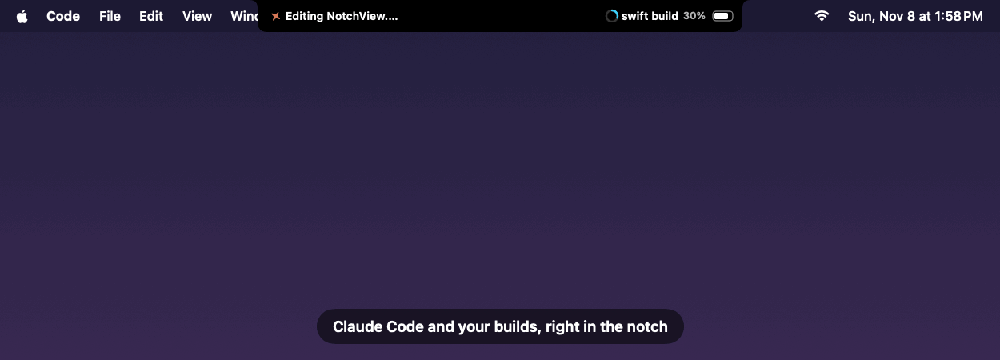

# Notchling

[](https://github.com/jazlynn-choy/Notchling/actions/workflows/ci.yml)
[](https://github.com/jazlynn-choy/Notchling/releases/latest)
[](LICENSE)

A notch hub for developers: supervise your AI coding agents, watch your builds, and keep music, to-dos and your calendar in view, all in the dead space around the MacBook camera notch.

- **Approve Claude Code from the notch.** When Claude asks permission ("Run `npm test`?"), the notch drops down with **Allow / Deny**. No window switching. If you don't answer in time, Claude asks in the terminal as usual: nothing is ever approved on its own.
- **`notch run <command>`** shows any terminal command's progress in the notch (latest output, "45%" or "3/10" progress), then ✓ or ✗ with how long it took, and a chime. Pipe into it (`npm test | notch`) or send a message (`notch "Deploy finished"`).

- **Collapsed:** slim black "wings" extend the notch and show what's playing (or the date), your open reminders count, the time, and battery.
- **Hover the notch:** a panel drops down with music controls and your **Apple Reminders**, synced both ways: add or tick off a reminder here and it updates on your iPhone.
- **Pick your widgets.** Choose what goes on the left of the notch, the right, and in the panel, and in what order:
  - **Beside the notch:** Claude Code status, now playing, date, time, battery, open reminders, focus timer, next calendar event, weather, world clock, countdown
  - **In the panel (stack cards in up to 4 columns):** Claude Code sessions, music, Reminders, focus timer, Calendar, weather, world clocks, countdown, notes, a Today tile
- **Claude Code in the notch:** see what each session is doing ("Editing NotchView.swift"), get a chime when it needs your permission or finishes, and see every session in one card.
- **Arrange it your way:** click the ✏️ in the panel, then drag cards anywhere. Drop a card **in the middle of another to swap them**, on its top or bottom strip to **stack** it above or below (up to 3 per column, 4 columns), or on a column's edge to give it its own column. Arrow buttons on each card move it without dragging. Drag a card's right edge for width and the bar between stacked cards for height. In Settings, drag rows to reorder and move wing widgets between sides. The whole panel goes up to 900×420 pt.
- **Music, Spotify first:** album art, play/pause/skip, **loop**, and **search all of Spotify**. Picking a song plays it within its album, so the album keeps going. Play works even when nothing's playing yet. The Spotify sign-in renews itself in the background, so it stays connected. Can search your Apple Music library instead.
- **Focus timer:** 5/15/25/50-minute sessions with a progress ring, a chime when done, and the time left shown beside the notch.
- **Calendar:** your next event ("Standup 12m") beside the notch, and the rest of today in the panel.
- **Everything else is adjustable** in Settings: wing width (down to zero), panel size, which Reminders list, haptics, and open at login.



<sub>Rendered from the app's real SwiftUI views with demo data (`make demo`).</sub>

## Install

1. Download **Notchling.zip** from the [latest release](https://github.com/jazlynn-choy/Notchling/releases/latest) and unzip it.
2. Drag **Notchling.app** into **Applications** and open it.
3. macOS will say it can't check the app for malicious software, because it isn't notarized by Apple (that needs a paid developer account). Go to **System Settings → Privacy & Security**, scroll down, and click **Open Anyway** next to Notchling. You only do this once.

Notchling runs on Apple silicon Macs (every MacBook with a notch is one).

## Requirements

- macOS 14 Sonoma or later. Best on a MacBook with a notch; other displays get a virtual one.
- Swift 6 toolchain (Xcode 16+, or the Command Line Tools)

## Build and run

```bash
make run      # release build → build/Notchling.app, then launch it
make test     # unit tests
make lint     # SwiftLint (needs `brew install swiftlint`)
```

On first use, macOS asks for permission to access Reminders and Calendar and to control Music/Spotify.

### Connect Claude Code

Settings → Claude Code → **Connect**. That adds two hooks to `~/.claude/settings.json`: one saves each session's latest status for the notch, and a `PermissionRequest` hook lets you answer permission prompts from the notch (switch it off, or change how long it waits, in the same section). Your other settings and hooks are kept, and the original file is backed up as `settings.json.before-notchling`. Only the event type, tool name, file or command and folder are kept, never your prompts or file contents. Restart open Claude Code sessions to pick it up. **Disconnect** removes exactly what was added.

### The `notch` command

Settings → The notch command → **Install** links `notch` onto your PATH (into Homebrew's `bin` if it's writable, else `~/.local/bin`). Then:

```bash
notch run npm run build          # progress in the notch, ✓/✗ + chime when done, same exit code
swift test 2>&1 | notch -t Tests # or pipe any output into it
notch "Deploy finished"          # a one-off message; also: notch done …, notch fail …
```

### Connect Spotify (for song search)

Spotify only lets apps search its catalog after you sign in through a Spotify developer app of your own. It's free and takes two minutes:

1. Go to [developer.spotify.com/dashboard](https://developer.spotify.com/dashboard) and **Create app** (any name).
2. Add the Redirect URI `http://127.0.0.1:43821/callback` and tick **Web API**.
3. Copy the app's **Client ID** into Notchling → Settings → Music, then click **Connect Spotify** and approve in your browser.

Notchling uses Spotify's PKCE sign-in, so there's no client secret in the app and your password only ever goes to Spotify. It stores just a refresh token, in your Keychain. Songs play in the Spotify desktop app.

### Keep permissions between builds

macOS remembers permissions per app *signature*. Without a certificate, each build gets a new throwaway signature, so macOS treats every rebuild as a new app and asks again. Create a local signing certificate once and `make run` will use it automatically:

1. Open **Keychain Access** → menu **Keychain Access → Certificate Assistant → Create a Certificate…**
2. Name: `Notchling Dev` · Identity Type: **Self Signed Root** · Certificate Type: **Code Signing** → **Create**
3. Run `make run` and grant permissions one last time. They'll stick from then on.

The certificate only lives in your keychain and is only good for apps on your own Mac.

## Project layout

```
Sources/
  NotchlingCore/   Models, layout math, state stores, and protocols over system services
    Models/        Todo, Track, NotchGeometry, due-date formatting
    Providers/     Protocols + EventKit, AppleScript, IOKit and SMAppService implementations
    Stores/        @MainActor ObservableObjects the UI binds to
  NotchlingUI/     SwiftUI views, one component per file
  Notchling/       App entry point, the floating panel, hover tracking, dependency wiring
Tests/
  NotchlingCoreTests/  Swift Testing suites with in-memory fakes
scripts/           bundle.sh (make the .app), test.sh
```

The architecture, and why it's built this way, is written up in [docs/ARCHITECTURE.md](docs/ARCHITECTURE.md).

## Testing

The core module is covered by 189 tests: the approval hook script (run for real: Allow, Deny and fall back to the terminal), the `notch` command's progress parsing and activity lifecycle, stacking, drop targets, drag-to-reorder and resize math, the Claude Code hook script (run for real against sample events) and its settings installer, layout geometry, the widget layout and its migration, card sizing, the focus timer, calendar labels, music search, the Spotify sign-in (including a real loopback-server test), weather parsing and caching, world clocks, date labels, sorting, AppleScript/IOKit parsing, settings persistence, and the reminders sync behaviour. The sync tests run against `FakeRemindersProvider`, so they need no permissions and touch none of your real data.

```bash
make test
```

## Releasing

Releases are built by GitHub Actions. Tag a version and push the tag:

```bash
git tag v0.2.0 && git push origin v0.2.0
```

The [release workflow](.github/workflows/release.yml) runs the tests, builds `Notchling.app` with that version number, zips it, and publishes a GitHub Release with the zip and its SHA-256 checksum.

## License

[MIT](LICENSE)

## Roadmap

- [ ] Developer ID signing, notarization and a `.dmg` release in CI
- [ ] Auto-updates (Sparkle)
- [ ] Apple Music catalog search (MusicKit)
- [ ] Multiple displays: follow the active screen
- [ ] Hide automatically over full-screen video
- [ ] Snapshot tests for the SwiftUI views
