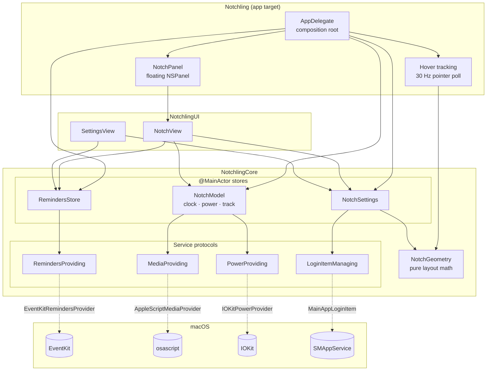

# Architecture

## Overview

Dependencies point one way: **App → UI → Core**. Core never imports SwiftUI. UI never touches window plumbing. Only the app target knows which concrete providers exist.

## Key decisions

### 1. Services behind protocols, injected at the composition root
Reminders, media, battery and login items each sit behind a small protocol (`Providers.swift`). `AppDelegate` is the only place real implementations are created. That lets `RemindersStore`'s sync logic (tick, grace period, undo, error rollback, external-change reload) be tested against an in-memory fake, without Reminders permission or the user's real data.

### 2. A transparent window that ignores the mouse, plus pointer polling
The window is always sized for the *expanded* panel so the open/close animation never resizes it, which would flicker. But a transparent window that size would swallow clicks meant for menu bar items under the wings. So:

- while collapsed, `ignoresMouseEvents = true`, and every click passes through to the menu bar;
- a 30 Hz timer checks `NSEvent.mouseLocation` against `NotchGeometry.openTriggerRect`. Only the notch itself opens the panel, not the wings, so moving along the menu bar doesn't trigger it;
- once open, the window takes mouse events, and the panel closes 250 ms after the pointer leaves `stayOpenRect`.

Alternatives considered: tracking areas (they don't fire while the window ignores the mouse) and a global event monitor (needs Accessibility permission). Polling a single point 30 times a second costs almost nothing.

### 3. Keyboard focus only when asked for
`NotchPanel` is non-activating with `becomesKeyOnlyIfNeeded`. Hovering never steals focus from the app you're typing in; only clicking the "Add a reminder" field does, and focus goes back to the previous app when the panel closes.

### 4. Pure layout math
`NotchGeometry` is a value type with no AppKit dependency. All the sizing (wing width, panel minimums, window frame, hover rects) is unit tested against a real 14" MacBook Pro's dimensions.

### 5. Swift 6 strict concurrency
The package builds in Swift 6 language mode with no warnings.
- Stores are `@MainActor`, so UI state is only ever mutated on the main thread, checked by the compiler.
- Providers are `Sendable` and do blocking work (EventKit fetches, `osascript`) off the main actor.
- `EventKitRemindersProvider` is `@unchecked Sendable` because `EKEventStore` predates Swift concurrency annotations but is documented thread-safe. `EKReminder` objects are converted to `Sendable` `Todo` values inside EventKit's callback, so they never cross threads.

### 6. Now playing via AppleScript
macOS has no public now-playing API, and the private MediaRemote framework is restricted on recent versions. Scripting Music and Spotify is public and reliable. The provider checks `runningApplications` first, because `tell application` would otherwise *launch* a player that isn't open. Fields are separated by ASCII 31 (unit separator), so song titles containing `|` or newlines parse correctly (tested).

### 7. Errors are surfaced, not swallowed
Failed fetches or saves set `RemindersStore.lastError`, shown as a warning icon with a tooltip. A failed "complete" un-ticks the row so the UI never claims something happened that didn't. A failed login-item change rolls the toggle back and shows the system's message.

### 8. Widgets are data, not views
`WidgetLayout` (in Core) is a plain value: three ordered lists of `WidgetKind`, one per slot. The UI just maps each kind to a view. That keeps the rules testable without SwiftUI: a widget only goes where it fits, appears once per slot, and slots have a maximum size. Every mutation goes through methods that enforce those rules, so the layout can't get into a state the UI has to defend against.

- **Persisted as strings, not `Codable`.** Synthesized decoding throws on an unknown enum value, which would wipe a user's whole layout if a widget were ever renamed or removed. Unknown entries are skipped instead (tested).
- **Migration from v0.1.** The old separate toggles are converted into an equivalent layout on first launch, then deleted, so upgrading keeps the user's setup and migration runs once.
- **Cost follows the layout.** If no widget shows music, the app stops running AppleScript every 2 seconds.
- **Adding a widget** takes a `WidgetKind` case (title, symbol, which slot it fits) and one branch in `WidgetViews.swift`. The `everyWidgetFitsExactlyOneKindOfSlot` test catches a case that was half added.

## Known limitations

- One display: the notch screen, or the main screen with a virtual notch.
- Music artwork isn't shown (AppleScript artwork access is slow and inconsistent between players).
- With only the Command Line Tools installed, SwiftPM intermittently fails to load the Swift Testing macro plugin. `scripts/test.sh` retries on that exact error. CI uses full Xcode and isn't affected.
