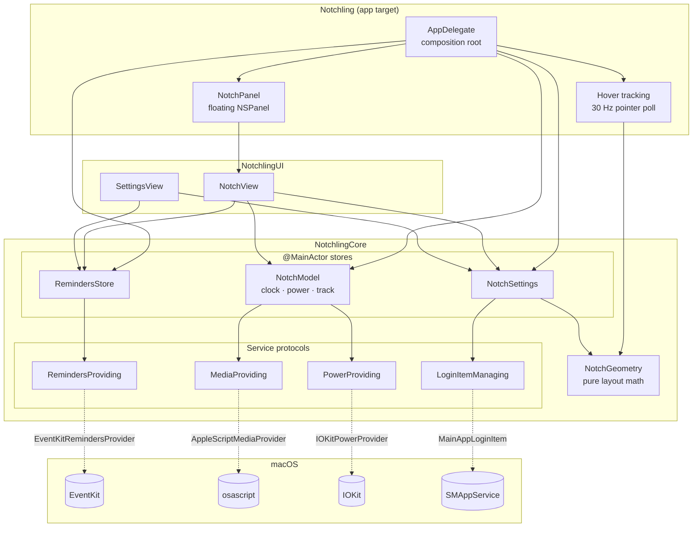

# Architecture

## Overview

Dependencies point one way: **App → UI → Core**. Core never imports SwiftUI. UI never touches window plumbing. Only the app target knows which concrete providers exist.

## Key decisions

### 1. Services behind protocols, injected at the composition root
Reminders, media, battery and login items each sit behind a small protocol (`Providers.swift`). `AppDelegate` is the only place real implementations are created. That lets `RemindersStore`'s sync logic (tick, grace period, undo, error rollback, external-change reload) be tested against an in-memory fake, without Reminders permission or the user's real data.

### 2. A transparent window that ignores the mouse, plus pointer polling
The window is always sized for the *expanded* panel so the open/close animation never resizes it, which would flicker. But a transparent window that size would swallow clicks meant for menu bar items under the wings. So:

- while collapsed, `ignoresMouseEvents = true`, and every click passes through to the menu bar;
- a 30 Hz timer checks `NSEvent.mouseLocation` against `NotchGeometry.openTriggerRect`. Only the notch itself opens the panel, not the wings, so moving along the menu bar doesn't trigger it;
- once open, the window takes mouse events, and the panel closes 250 ms after the pointer leaves `stayOpenRect`.

Alternatives considered: tracking areas (they don't fire while the window ignores the mouse) and a global event monitor (needs Accessibility permission). Polling a single point 30 times a second costs almost nothing.

### 3. Keyboard focus only when asked for
`NotchPanel` is non-activating with `becomesKeyOnlyIfNeeded`. Hovering never steals focus from the app you're typing in; only clicking the "Add a reminder" field does, and focus goes back to the previous app when the panel closes.

### 4. Pure layout math
`NotchGeometry` is a value type with no AppKit dependency. All the sizing (wing width, panel minimums, window frame, hover rects) is unit tested against a real 14" MacBook Pro's dimensions.

### 5. Swift 6 strict concurrency
The package builds in Swift 6 language mode with no warnings.
- Stores are `@MainActor`, so UI state is only ever mutated on the main thread, checked by the compiler.
- Providers are `Sendable` and do blocking work (EventKit fetches, `osascript`) off the main actor.
- `EventKitRemindersProvider` is `@unchecked Sendable` because `EKEventStore` predates Swift concurrency annotations but is documented thread-safe. `EKReminder` objects are converted to `Sendable` `Todo` values inside EventKit's callback, so they never cross threads.

### 6. Now playing via AppleScript
macOS has no public now-playing API, and the private MediaRemote framework is restricted on recent versions. Scripting Music and Spotify is public and reliable. The provider checks `runningApplications` first, because `tell application` would otherwise *launch* a player that isn't open. Fields are separated by ASCII 31 (unit separator), so song titles containing `|` or newlines parse correctly (tested).

### 7. Errors are surfaced, not swallowed
Failed fetches or saves set `RemindersStore.lastError`, shown as a warning icon with a tooltip. A failed "complete" un-ticks the row so the UI never claims something happened that didn't. A failed login-item change rolls the toggle back and shows the system's message.

### 8. Widgets are data, not views
`WidgetLayout` (in Core) is a plain value: three ordered lists of `WidgetKind`, one per slot. The UI just maps each kind to a view. That keeps the rules testable without SwiftUI: a widget only goes where it fits, appears once per slot, and slots have a maximum size. Every mutation goes through methods that enforce those rules, so the layout can't get into a state the UI has to defend against.

- **Persisted as strings, not `Codable`.** Synthesized decoding throws on an unknown enum value, which would wipe a user's whole layout if a widget were ever renamed or removed. Unknown entries are skipped instead (tested).
- **Migration from v0.1.** The old separate toggles are converted into an equivalent layout on first launch, then deleted, so upgrading keeps the user's setup and migration runs once.
- **Cost follows the layout.** If no widget shows music, the app stops running AppleScript every 2 seconds.
- **Adding a widget** takes a `WidgetKind` case (title, symbol, which slot it fits) and one branch in `WidgetViews.swift`. The `everyWidgetFitsExactlyOneKindOfSlot` test catches a case that was half added.

### 9. Time-based features store dates, not counters
The focus timer keeps the *date it ends*, not a seconds-left counter that ticks down. If the Mac sleeps or a tick runs late, the remaining time is still exact, because it's always worked out as `end − now`. The clock is injected, so tests move time forward by hand instead of waiting. Calendar labels take `now`, a `Calendar` and a `Locale`, so they're tested in a fixed time zone. Those tests also caught that macOS formats "6:00 PM" with a narrow no-break space.

### 10. Search is safe to type anything into
The song search sends what you type to AppleScript as an *argument* (`on run argv`), never pasted into the script source, so quotes or backslashes can't change what the script does. Typing is debounced, and each keystroke cancels the previous search, so a slow result for "ta" can't overwrite the results for "taylor" (tested). Playing songs outside your library would need MusicKit or the Spotify Web API, both with accounts and keys, so those hand off to Spotify's own search instead.

### 11. Permissions and signing
macOS ties privacy permissions to an app's code signature. `scripts/bundle.sh` signs with a stable local `Notchling Dev` certificate when there is one, so permissions survive rebuilds, and warns when it has to fall back to ad hoc signing.

### 12. Spotify sign-in: PKCE, loopback redirect, Keychain
Searching Spotify's catalog needs a Web API token. Notchling uses **Authorization Code with PKCE**, the flow meant for apps that can't keep a secret:

- The app makes a random verifier and sends only its SHA-256 hash with the sign-in, then proves it holds the verifier when it swaps the code for tokens. No client secret is shipped. Tested against the RFC 7636 example.
- The browser redirects to `http://127.0.0.1:43821/callback`, caught by a one-shot `NWListener` bound to loopback only. It ignores stray requests like `/favicon.ico`, shuts down after the first real callback, and times out after 3 minutes. A test drives it with real HTTP requests.
- The `state` parameter is checked, so a page can't inject its own code (tested).
- Only the refresh token is stored, in the **Keychain**. Access tokens stay in memory and refresh a minute before they expire. Two searches at once share **one** refresh (tested). A revoked token signs the user out cleanly instead of failing forever.
- Search asks for **no scopes**. Playback goes through the Spotify app's AppleScript `play track`, so it works on free accounts too.

### 13. Network widgets fail soft
Weather comes from Open-Meteo (no key, no account), is cached for 20 minutes, and is only fetched while a weather widget is in the layout. A failed update keeps showing the last report with a small error, rather than blanking the widget (tested). All network access goes through an `HTTPClient` protocol, so parsing and error paths are tested with fixtures trimmed from real responses.

### 14. Card sizes are weights, and editing is pure math
Each panel card has a *weight* (its share of the width) rather than a fixed width, so a layout still works when the panel itself is resized. `PanelLayout.widths` splits the width, with a minimum so a narrow card next to wide ones stays usable.

In edit mode, the hard parts are pure functions, tested without SwiftUI:
- **Resizing** works out the weight that makes the dragged card exactly as wide as the pointer asks, with the others unchanged, so the handle stays under the cursor. It's tested for every position. The drag uses global coordinates, because the card's own frame changes as it resizes, which would otherwise feed back into the gesture.
- **Reordering** moves a card past a neighbour once its centre crosses the neighbour's centre, the same rule as iOS home screens.
- Saved sizes from the previous S/M/L version still load. A "small" string becomes weight 1.

### 17. Stacked columns without a new data shape
To stack weather under music, the panel became columns of up to three cards. Rather than change the stored layout to nested arrays, `WidgetLayout` keeps the panel as a flat ordered list plus a set of cards that are *stacked under the card before them*:

- Every older saved layout is valid as is (no flags means one card per column), so there's no migration.
- Code that only needs "which widgets are shown" (polling decisions, Settings rows) keeps working on the flat list.
- Structural edits go through `panelColumns` and `drop(_:at:)`, which build columns, change them, and write them back through one setter that enforces every limit: column height, column count, no empties, no duplicates. Odd cases are tested, like removing a top card (the one below takes its place rather than joining the column to its left) or moving a lone card right (the index shifts as its old column disappears).

In the panel, cards are positioned from `PanelLayout.frames`, so the drop target under the pointer is a pure function of the point and those frames. Stack above or below by card half, new column in a column's outer fifth or the gap between columns. The divider between stacked cards moves weight between the pair only, so nothing else in the column shifts. All of this is tested.

### 16. Staying signed in to Spotify
The access token lasts an hour. `keepAlive()` runs at launch, after every wake from sleep, and every 30 minutes, renewing the token once it's within 20 minutes of expiring. Being offline never signs you out; only Spotify rejecting the refresh token does, and then the UI says so instead of failing silently. Spotify can rotate refresh tokens, so the newest is always saved (tested).

### 15. Claude Code status through hooks
Claude Code runs configured commands on lifecycle events (`SessionStart`, `PreToolUse`, `Notification`, `Stop`…), passing the event as JSON on stdin. Notchling installs one small `sh` script as that command:

- **It must never hurt Claude Code.** It uses only base-system tools (`plutil` reads and edits JSON), prints nothing, has a 5-second timeout, and always exits 0. A test runs the real script and checks this.
- **Atomic, one file per session.** It writes to a temp file and `mv`s it to `<session_id>.json`, so the app never reads half a file. The session ID is filtered to `[A-Za-z0-9-]`, so a crafted ID like `../../x` can't write outside the folder (tested).
- **Privacy.** Prompts, tool output and file contents (`prompt`, `tool_response`, `tool_input.content`, edit strings) are deleted before the event is saved (tested).
- **Reading.** The app reads that folder once a second, only while a Claude Code widget is shown. Ended sessions are removed, files older than a day are cleaned up, and a "working" session silent for 30 minutes is shown as quiet, in case Claude was killed without a `Stop`.
- **Installing into someone's settings.** The merge adds Notchling's entries next to any existing hooks, is idempotent, and is reversed exactly by Disconnect. It refuses to touch a settings file that isn't valid JSON, and keeps a one-time backup. All of this is tested on temp files.

### 18. Approving Claude Code from the notch: fail safe by construction
Claude Code's `PermissionRequest` hook fires only when it's about to ask you something. Ours writes the request to `approvals/<uuid>.request.json` and polls for `<uuid>.decision` for up to N seconds (10–120, configurable).

- **The default outcome is "no decision".** It applies on timeout, on "Ask in terminal", when Notchling isn't running (checked with `pgrep` before waiting), and when approvals are switched off (a flag file the app owns). Claude Code then asks in the terminal exactly as it would without Notchling. The only way to approve is a click on a request you can see.
- **The hook's own timeout (150 s) is longer than the longest wait**, so Claude Code never kills it mid-answer.
- **Files, not sockets.** Both sides already share a folder, there's no port to manage or secure, and a crashed app just means no answer. Answers are written then renamed, so they're never half-read. Request IDs come from `uuidgen` and are checked on both sides, so a crafted file name can't make the app write elsewhere. Every `rm` uses `${var:?}`, so an empty variable stops the script instead of widening a delete.
- **The panel stays open** while a request is pending, even if the pointer leaves, and quitting the app hands every waiting request straight back to the terminal.
- **Tested end to end:** the real script runs with a fake `HOME`, and the test plays the app's role through the same channel class. For Allow, Deny and Ask it checks the exact JSON Claude Code receives, that the files are cleaned up, and that a late answer is rejected.

### 19. The `notch` command
A second executable in the package, sharing a tiny Foundation-only `NotchlingActivity` module with the app. That gives one `Codable` type on both sides, so the format can't drift, and the CLI stays small and fast to start (no AppKit).

- **It must be invisible:** output is copied through unchanged, `notch run` exits with the command's own status (or 128+signal), and failing to report never fails the command.
- **Ctrl-C:** `notch` installs a no-op SIGINT handler instead of ignoring the signal. Ignored signals are inherited across `exec`, handlers aren't, so the child still stops on Ctrl-C while `notch` survives to report "Interrupted".
- **Liveness:** it writes at most 4 times a second, and at least every 10 s even when the command is silent. The app marks a "running" activity that goes quiet for 45 s as stopped, so a killed terminal doesn't leave a spinner forever.
- **Progress parsing** handles `45%`, `62.5 %`, `3/10`, `3 of 10`, colour codes and `\r` redraws, and ignores things like `150%` or `11/10`. It's a pure function with table-driven tests.
- **Install** symlinks the copy inside the app bundle, so it updates with the app, and it refuses to overwrite any other program called `notch`. Nested code is signed before the app bundle.

### 20. The README demo is rendered, not recorded
`make demo` runs `Tools/NotchlingDemo`, which builds the real `NotchView` with demo data, using fakes of the same provider protocols the app uses. It renders a storyboard with `ImageRenderer` and writes `docs/demo.gif` and `docs/screenshot.png` with ImageIO. It needs no screen-recording permission, it's sharp, and it's the same every time, so it can be regenerated whenever the UI changes.

`ImageRenderer` can't draw AppKit-backed views, so a `notchSnapshot` environment flag swaps scroll views and text fields for plain equivalents. Nothing else differs. Watching the frames caught a real bug: the approval card showed Claude's *description* of a command instead of the command itself. It now always shows the exact command or path, with the description as a caption (tested).

## Known limitations

- One display: the notch screen, or the main screen with a virtual notch.
- Spotify's Web API requires each user to register their own developer app (see README); a published app would register one and ship its Client ID.
- Music artwork isn't shown (AppleScript artwork access is slow and inconsistent between players).
- With only the Command Line Tools installed, SwiftPM intermittently fails to load the Swift Testing macro plugin. `scripts/test.sh` retries on that exact error. CI uses full Xcode and isn't affected.
